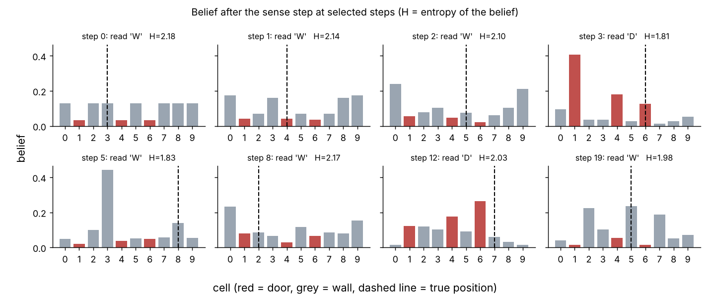
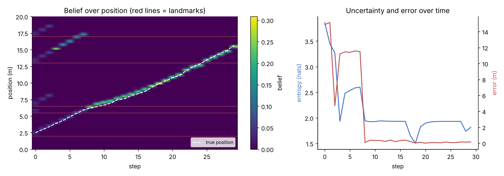
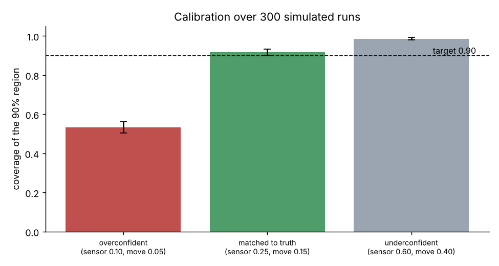

# Bayes localisation in one dimension

A discrete Bayes filter (histogram filter) written from scratch in `numpy`, with simulation experiments that test how well it locates a robot and how honest it is about its own uncertainty.

This is a learning project. It follows the standard textbook method (Thrun, Burgard and Fox, *Probabilistic Robotics*, chapter 4) and is not new research. Only `numpy` and `matplotlib` are used, and every step is written out so it can be checked by hand.

## What is in the notebook

`bayes_localisation.ipynb` has five parts:

1. **Bayes' rule on three cells.** A robot in a wall, door, wall world reads "door" with a sensor that is right 80% of the time. The code reproduces the hand calculation (1/6, 2/3, 1/6) and asserts that it matches.
2. **Sense and move on a loop of 10 cells.** The move step blurs the belief and the sense step sharpens it. The notebook measures how often the most probable cell is the true cell.
3. **A 20 m corridor with a noisy range sensor and noisy motion.** 201 position cells, five known landmarks, a sensor that reports the distance to the nearest landmark (standard deviation 0.25 m) and 0.5 m moves with 0.15 m of error.
4. **A calibration check.** Is the filter's 90% region right 90% of the time?
5. **Limits and next steps.**

## Results

**Section 2: a weak sensor on a short loop never fully locks on.** Entropy stalls because every move adds uncertainty and a door/wall reading carries little information (seven of the ten cells look like "wall"). Averaged over 300 runs, the most probable cell is the true cell about 35% of the time against a chance level of 10%. This is a limit of the sensor and the map, not a bug.



**Section 3: with a range sensor, the filter locks on.** The belief starts with several peaks because the sensor does not say which landmark it saw. Motion separates them, and by step 8 more than 90% of the belief is within 0.5 m of the best guess. The final error in the example run is 0.16 m.



**Section 4: calibration over 300 simulated runs.** The same simulated data was given to three versions of the filter. At the last step, I checked whether the true position was inside the smallest region holding 90% of the belief.

| Noise assumed by the filter | Truth inside the 90% region | Mean region width |
|---|---|---|
| Too small (sensor 0.10 m, move 0.05 m) | 53% (standard error 2.9 points) | 0.24 m |
| Matched to the simulation (0.25 m, 0.15 m) | 92% (1.6 points) | 0.57 m |
| Too large (sensor 0.60 m, move 0.40 m) | 99% (0.7 points) | 1.25 m |

A filter that is told the noise is smaller than it is gives narrow regions that are wrong almost half the time. A filter that is told the noise is larger is almost always right but gives regions more than twice as wide. Getting the noise model right matters as much as the algorithm.



## Limits

- The simulation uses the noise model the filter assumes, so the matched result is a best case. I tested wrong noise sizes, but not non-Gaussian errors, outliers, a wrong map or a robot that is picked up and moved.
- The map and the move commands are assumed known. This is localisation, not mapping.
- A histogram filter does not scale. 201 cells is fine in one dimension, but a 20 m by 20 m area at 0.1 m resolution is 40,000 cells, and adding heading makes it millions. Particle filters and Kalman filters are what is used in practice.
- The calibration check uses only the final time step of 300 runs.

## Running it

```
pip install -r requirements.txt
jupyter notebook bayes_localisation.ipynb
```

All random numbers use fixed seeds, so the printed results are reproducible. Figures are saved to `figures/` when the notebook runs.

## Possible next steps

- Replace the histogram filter with a particle filter and compare coverage and run time.
- Run the same code on real range logs from a public robot dataset.
- Feed the belief into a planner that picks moves to reduce uncertainty fastest.
